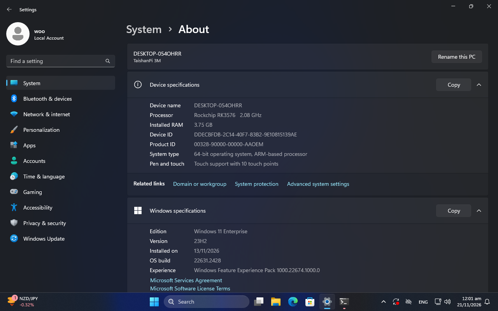

# woa-rk3576

English | [简体中文](README.zh-CN.md)

Windows on Arm drivers for Rockchip RK3576 boards (ArmSoM CM5-IO, LCKFB
TaishanPi 3M, Radxa ROCK 4D), and the WinPE image and scripts that install
Windows 11 23H2 on the eMMC (NVMe on the ROCK 4D). The firmware comes first:
[edk2-rk3576](https://github.com/gahingwoo/edk2-rk3576#from-a-new-board-to-windows-or-linux).

## Install

1. Write the edk2-rk3576 firmware to the eMMC as the whole image (ROCK 4D:
   SPI NOR and NVMe, see [its notes](docs/INSTALL.md#radxa-rock-4d)).
2. Follow [docs/INSTALL.md](docs/INSTALL.md): WinPE stick from the
   [latest release](https://github.com/gahingwoo/woa-rk3576/releases/latest),
   `install.wim` from a Windows 11 23H2 ARM64 ISO, one script.

[Maskrom Studio](https://github.com/gahingwoo/maskrom-studio) does the same
install from a PC without a stick (CI only).

Then: [using the hardware](docs/features.md),
[adding and replacing drivers](docs/drivers.md),
[troubleshooting](docs/troubleshooting.md).

## Status

Windows 11 23H2 (22631). board-tested: seen working on that board.
CI only: builds in CI, not run on that board. branch: needs a firmware
branch that is not on `main`. "ci fw": needs edk2-rk3576 newer than 0.4.1
(its `ci` build until the next release). not tried: not run on that board.
The ROCK 4D runs Windows from its NVMe drive and needs ci fw for all of it
(its ACPI tables are only on edk2-rk3576 `main`).

| Feature | Driver | CM5-IO | TaishanPi 3M | ROCK 4D | Note |
|---|---|---|---|---|---|
| eMMC (boot disk) | dwcsdhc | board-tested | board-tested | n/a | |
| SD card | dwcmshc | board-tested | CI only | not tried | TaishanPi 3M: driver starts, no card tried |
| NVMe | inbox stornvme | board-tested | n/a | board-tested | ROCK 4D: the boot disk |
| USB-A | inbox usbxhci | board-tested | board-tested | not tried | |
| USB-C | inbox usbxhci | board-tested | board-tested | not tried | CM5-IO: USB 2.0. TaishanPi 3M: device attached at power-on only, ci fw |
| Ethernet | dwc_eqos | board-tested | board-tested | board-tested | ROCK 4D: ci fw (RTL8211F RGMII delays) |
| GPIO, I2C, SPI, DMA | rk3xgpio, rk3xi2c, rk3xspi, pl330dma | board-tested | board-tested | not tried | drivers start |
| 40-pin header for apps | rk3xuart, inbox rhproxy | branch | CI only | CI only | off by default in firmware; [40-pin header](docs/pin40.md) |
| Display, framebuffer | inbox BasicDisplay | board-tested | board-tested | board-tested | one mode |
| Display, GPU | [wddm-mali-g52](https://github.com/gahingwoo/wddm-mali-g52) | CI only | board-tested | board-tested | |
| Touch (DSI screen) | gt9271 | CI only | board-tested | n/a | ci fw |
| Headphone jack, microphone | rk3xi2sbus, csaudiork3x, es8323 | n/a | board-tested | board-tested | ci fw. ROCK 4D: jack detect (rk3xsaradc) not tried |
| HDMI audio | the same | CI only | board-tested | board-tested | with wddm-mali-g52, ci fw |
| Bluetooth | bcm4345bt | CI only | board-tested | none | no voice, ci fw |
| Wi-Fi | none | none | none | none | [wireless](docs/dev/wireless.md) |
| NPU | [woa-rk3576-npu](https://github.com/gahingwoo/woa-rk3576-npu) | none | board-tested | board-tested | |
| Video decoder (VDPU383) | vdpu383 | CI only | board-tested | board-tested | test tool only, no players yet |
| ADC keys | [rk3xsaradc](drivers/adc/rk3xsaradc) | CI only | CI only | CI only | TaishanPi 3M: Recovery key = power button |
| Power button (RK806) | [rk806pwrkey](drivers/input/rk806pwrkey) | branch | n/a | CI only | |
| Board LEDs | [rkled](drivers/leds/rkled) | branch | CI only | CI only | |
| Hardware watchdog | inbox (firmware WDAT) | CI only | CI only | CI only | test with [wdthang](tools/wdthang) |
| RTC, PMIC, pin controller | [null](drivers/null) | CI only | board-tested | board-tested | no driver needed, only names the devices |
| EEPROM | [rkeeprom](drivers/misc/rkeeprom) | n/a | n/a | CI only | |

Each result is from one board. Details: [features](docs/features.md).

## Releases

Tagged releases carry the WinPE image (`woa-rk3576-winpe-<tag>.img.xz`),
the drivers and `SHA256SUMS.txt`. The touch, Bluetooth and audio drivers are
newer than 0.1.1.

The [`ci`](https://github.com/gahingwoo/woa-rk3576/releases/tag/ci)
pre-release holds the WinPE image of the latest successful build of `main`
(`woa-rk3576-winpe-ci-<sha>.img.xz`). Every successful build replaces it and
it is untested as a whole. Use a tagged release unless you need a change
that is only on `main`. Maskrom Studio's CI tier uses it.

## For developers

[Architecture](docs/dev/architecture.md), [building](docs/dev/building.md),
[debugging](docs/dev/debugging.md), [crash dumps](docs/dev/crashdump.md),
[audio](docs/dev/audio.md), [display](docs/dev/display.md),
[wireless](docs/dev/wireless.md), [video decode](docs/dev/video-decode.md),
[EC20 4G](docs/dev/ec20.md), [history](docs/history/README.md).

## Acknowledgements

Thanks to [JLC](https://jlc.com/) (嘉立创) for sponsoring the LCKFB TaishanPi 3M, its MIPI DSI screen, the fan and the EC20 4G module used for this work, and to [ArmSoM](https://www.armsom.org/) for sponsoring the CM5 module and the CM5-IO board.

The ported drivers are the work of the worproject Rockchip-Windows-Drivers
authors: Mario Bălănică (SD/eMMC), CoolStar (GPIO, I2C, DMA, audio) and Doug
Cook (Ethernet), building on Microsoft's driver samples.

## License

Code written for this repository is GPL-2.0-only ([LICENSE](LICENSE)).
Releases before this change were MIT and stay MIT. The ported drivers keep
their own licences, and RK3576 changes to them are made under the same
licence as the driver they change; see [THIRD_PARTY.md](THIRD_PARTY.md).
