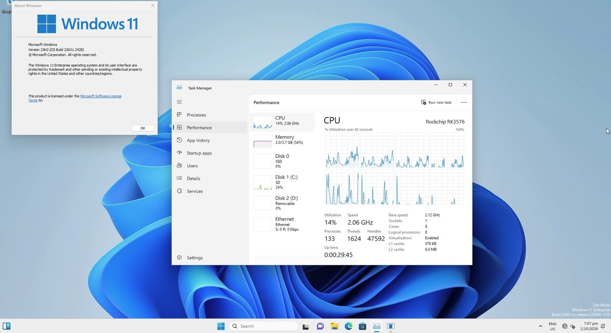

# woa-rk3576

[](https://github.com/gahingwoo/woa-rk3576/actions/workflows/ci.yml)
[](LICENSE)

Windows on Arm drivers for Rockchip RK3576 boards, and the tools to install
Windows on one. Tested on the ArmSoM CM5-IO and the LCKFB TaishanPi 3M.

Windows finds hardware through ACPI. The firmware and its ACPI tables are in
[edk2-rk3576](https://github.com/gahingwoo/edk2-rk3576); this repo has the
drivers for the controllers Windows has no inbox driver for.



Windows 11 23H2 boots to the desktop from the CM5-IO's eMMC with all eight
cores, 3.7 GB of memory, the NVMe, the SD card, Ethernet and both USB
controllers. It needs firmware 0.2.0 or later. How to install it:
[docs/INSTALL.md](docs/INSTALL.md).

## Status

| Peripheral | `_HID` | Driver | State |
|---|---|---|---|
| eMMC | `RKCP0D40` | [dwcsdhc](drivers/sd/dwcsdhc) (sdport) | works; Windows boots from it |
| SD card | `RKCPFE2C` | [dwcmshc](drivers/sd/dwcmshc) (sdport) | works, including eject and reinsert |
| GPIO | `RKCP3002` | [rk3xgpio](drivers/gpio/rk3xgpio) (GpioClx) | started, all 5 banks; SD card detect runs through it |
| I²C | `RKCP3001` | [rk3xi2c](drivers/i2c/rk3xi2c) (SpbCx) | started, all 10; no I²C device exercised |
| DMA | `ARMH0330` | [pl330dma](drivers/dma/pl330dma) | started, all 3 |
| Ethernet | `RKCP6543` | [dwc_eqos](drivers/net/dwc_eqos) (NetAdapterCx) | works, gets a DHCP lease |
| SPI | `RKCP3003` | [rk3xspi](drivers/spi/rk3xspi) (SpbCx) | started, all 5; no SPI device exercised |
| NVMe | PCIe | inbox stornvme | works |
| USB | `PNP0D10` | inbox usbxhci | works on both controllers; USB-C at USB 2.0 |
| Display | none | inbox BasicDisplay | the firmware's framebuffer, one mode ([display](docs/DISPLAY.md)) |
| Audio | none | none | not possible yet ([audio](docs/AUDIO.md)) |

Most of these were measured once, on 2026-10-01.

## LCKFB TaishanPi 3M

The same drivers, unchanged, on a second board. On 13 November 2026 Windows
11 23H2 (22631.2428) was deployed to the TaishanPi 3M's 64 GB eMMC with the
WinPE and the script from this repo, and boots to the desktop from it. It
needs the TaishanPi firmware from the
[0.3.0-tspi3m.1 pre-release](https://github.com/gahingwoo/edk2-rk3576/releases/tag/0.3.0-tspi3m.1)
of edk2-rk3576, with the firmware on the eMMC.

Seen on that one installation: eight cores, 3.8 GB of memory, the eMMC as the
boot disk, Ethernet at 1 Gbps with a DHCP lease and a 5 MB download, USB
keyboard, mouse and storage on the USB-A ports. The SD controller, GPIO, I2C,
DMA and SPI drivers all start; none of them was exercised beyond that, and no
SD card was tried. The board was provided by LCKFB.

Not available: the USB-C port (left out of the board's ACPI tables), WiFi and
Bluetooth, audio, the RTC (so the clock is wrong until it syncs) and the EC20
modem.

## Where the drivers come from

They are ports of
[worproject/Rockchip-Windows-Drivers](https://github.com/worproject/Rockchip-Windows-Drivers),
the RK3588 drivers, which bind the same ACPI `_HID`s. The import at `e00e70d`
is one unmodified commit, and each RK3576 change is its own commit after it,
so `git log -- drivers/<class>/<name>` shows what differs from RK3588:

- dwcsdhc: card clock from the CRU instead of a TF-A SiP call; Rockchip vendor
  bits restored after each controller reset.
- dwcmshc: clock from the CRU, phases in the controller's `TIMING_CON`, 3.3 V
  only.
- rk3xgpio: accepts GPIO version `V2_2`.
- dwc_eqos: turns on the DMA's 40-bit addressing (EAME). RK3576's memory runs
  past 4 GB, and without it every transfer to a buffer above 4 GB faulted.
- rk3xspi is written for this repo; the RK3588 set has no SPI driver.

Licences per driver: [THIRD_PARTY.md](THIRD_PARTY.md).

## Build

```cmd
msbuild build\RockchipDrivers.sln /p:Configuration=Release /p:Platform=ARM64
msbuild drivers\spi\rk3xspi\rk3xspi.vcxproj /p:Configuration=Release /p:Platform=ARM64
```

CI builds both on every push. The WinPE workflow also test-signs the drivers
and puts them in a WinPE image. Details: [docs/BUILDING.md](docs/BUILDING.md).
Debugging tools: [docs/DEBUGGING.md](docs/DEBUGGING.md).

## Layout

```
build/                  RockchipDrivers.sln, common.props (from worproject)
drivers/
  sd/dwcsdhc/           eMMC host (DWCMSHC)        sdport miniport
  sd/dwcmshc/           SD host (dw_mmc)           sdport miniport
  gpio/rk3xgpio/        GPIO                       GpioClx
  i2c/rk3xi2c/          I²C                        SpbCx
  dma/pl330dma/         PL330 DMA
  net/dwc_eqos/         Ethernet (DWC EQoS)        NetAdapterCx
  spi/rk3xspi/          SPI                        SpbCx (written here)
  audio/                RK3588 I²S drivers, not built into the image
  lib/, shared/, include/, sd/rk_sip_sdmmc_lib/   shared code
tools/
  woa-deploy/           install Windows to the eMMC from WinPE
  woa-debug/            collect data in WinPE and in the installed system
  make-woa-usb.sh       a Windows Setup stick that boots without NVRAM
docs/
.github/workflows/      CI and the WinPE image
```

## Acknowledgements

Thanks to [ArmSoM](https://www.armsom.org/) for sponsoring the CM5 module and
the CM5-IO carrier this project is developed on.

The drivers are the work of the worproject Rockchip-Windows-Drivers authors:
Mario Bălănică (SD/eMMC), CoolStar (GPIO, I²C, DMA, audio) and Doug Cook
(Ethernet), building on Microsoft's driver samples.

## License

Code written for this repo is MIT ([LICENSE](LICENSE)). The ported drivers keep
their own licences; see [THIRD_PARTY.md](THIRD_PARTY.md).
