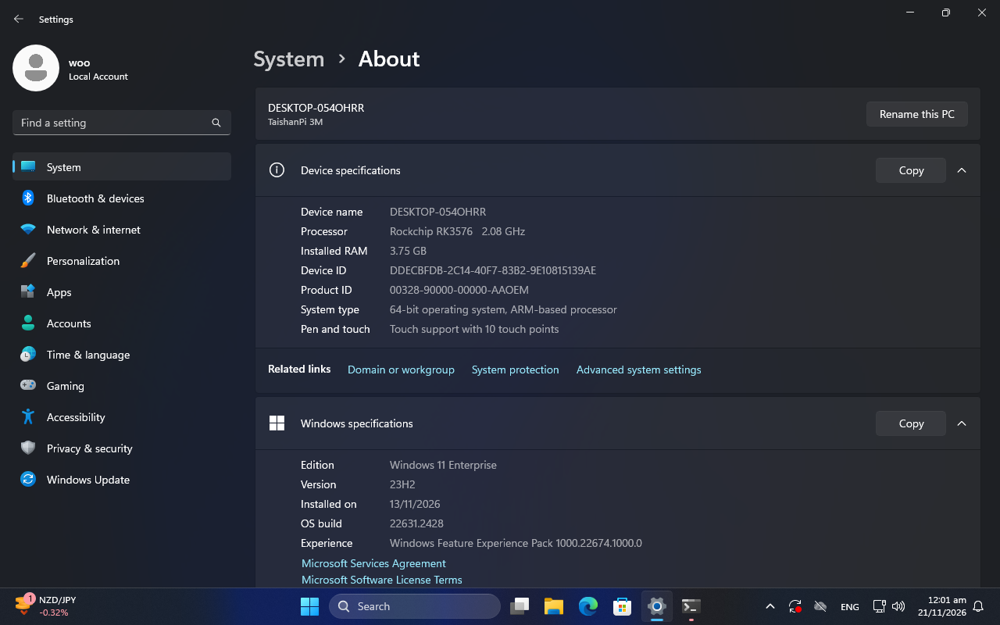

# woa-rk3576

[English](README.md) | 简体中文

Rockchip RK3576 开发板（ArmSoM CM5-IO、立创泰山派 3M、Radxa ROCK 4D）的 Windows on Arm 驱动，以及把 Windows 11 23H2 装到 eMMC（ROCK 4D 上是 NVMe）上的 WinPE 映像和脚本。先装固件：[edk2-rk3576](https://github.com/gahingwoo/edk2-rk3576/blob/main/README.zh-CN.md)。

## 安装

1. 把 edk2-rk3576 固件以完整映像写到 eMMC（ROCK 4D：SPI NOR 和 NVMe，见[它的说明](docs/INSTALL.zh-CN.md#radxa-rock-4d)）。
2. 按[安装说明](docs/INSTALL.zh-CN.md)操作：[最新正式版](https://github.com/gahingwoo/woa-rk3576/releases/latest)的 WinPE U 盘，Windows 11 23H2 ARM64 ISO 里的 `install.wim`，运行一个脚本。

也可以用 [Maskrom Studio](https://github.com/gahingwoo/maskrom-studio) 在电脑上直接安装，不用 U 盘（仅 CI）。

之后：[在 Windows 下使用硬件](docs/features.zh-CN.md)、[添加和替换驱动](docs/drivers.zh-CN.md)、[故障排查](docs/troubleshooting.zh-CN.md)。

## 状态

Windows 11 23H2（22631）。板测：在该板上实际跑通。仅 CI：CI 能编译，没在该板上跑过。没试过：没在该板上跑过。下面所有功能都需要 [edk2-rk3576 0.5.0](https://github.com/gahingwoo/edk2-rk3576/releases/tag/0.5.0) 或更新的固件。ROCK 4D 从 NVMe 运行 Windows。

| 功能 | 驱动 | CM5-IO | 泰山派 3M | ROCK 4D | 备注 |
|---|---|---|---|---|---|
| eMMC（系统盘） | dwcsdhc | 板测 | 板测 | 无此硬件 | |
| SD 卡 | dwcmshc | 板测 | 仅 CI | 没试过 | 泰山派 3M：驱动能启动，没插卡试过 |
| NVMe | 系统自带 stornvme | 板测 | 无此硬件 | 板测 | ROCK 4D：系统盘 |
| USB-A | 系统自带 usbxhci | 板测 | 板测 | 没试过 | |
| USB-C | 系统自带 usbxhci | 板测 | 板测 | 没试过 | CM5-IO：USB 2.0。泰山派 3M：只认上电时已插的设备 |
| 以太网 | dwc_eqos | 板测 | 板测 | 板测 | |
| GPIO、I2C、SPI、DMA | rk3xgpio、rk3xi2c、rk3xspi、pl330dma | 板测 | 板测 | 没试过 | 驱动能启动 |
| 40 针排针供应用使用 | rk3xuart、系统自带 rhproxy | 仅 CI | 仅 CI | 仅 CI | 固件里默认关闭；[40 针排针](docs/pin40.zh-CN.md) |
| 显示，帧缓冲 | 系统自带 BasicDisplay | 板测 | 板测 | 板测 | 一个分辨率 |
| 显示，GPU | [wddm-mali-g52](https://github.com/gahingwoo/wddm-mali-g52) | 仅 CI | 板测 | 板测 | |
| 触摸（DSI 屏） | gt9271 | 仅 CI | 板测 | 无此硬件 | |
| 耳机孔、麦克风 | rk3xi2sbus、csaudiork3x、es8323 | 无此硬件 | 板测 | 板测 | ROCK 4D：插拔检测（rk3xsaradc）没试过 |
| HDMI 音频 | 同上 | 仅 CI | 板测 | 板测 | 配合 wddm-mali-g52 |
| 蓝牙 | bcm4345bt | 仅 CI | 板测 | 无 | 不能通话 |
| Wi-Fi | 无 | 无 | 无 | 无 | [无线](docs/dev/wireless.zh-CN.md) |
| NPU | [woa-rk3576-npu](https://github.com/gahingwoo/woa-rk3576-npu) | 无 | 板测 | 板测 | |
| 视频解码器（VDPU383） | vdpu383 | 仅 CI | 板测 | 板测 | 只有测试工具，播放器还不能用 |
| ADC 按键 | [rk3xsaradc](drivers/adc/rk3xsaradc) | 仅 CI | 仅 CI | 仅 CI | 泰山派 3M：Recovery 键作电源按钮 |
| 电源键（RK806） | [rk806pwrkey](drivers/input/rk806pwrkey) | 仅 CI | 无此硬件 | 仅 CI | |
| 板载指示灯 | [rkled](drivers/leds/rkled) | 仅 CI | 仅 CI | 仅 CI | |
| 硬件看门狗 | 系统自带（固件 WDAT） | 仅 CI | 仅 CI | 仅 CI | 用 [wdthang](tools/wdthang) 测试 |
| RTC、PMIC、引脚控制器 | [null](drivers/null) | 仅 CI | 板测 | 板测 | 不需要驱动，只给设备起名 |
| EEPROM | [rkeeprom](drivers/misc/rkeeprom) | 无此硬件 | 无此硬件 | 仅 CI | |

每项结果都来自同一块板子。细节见[硬件功能](docs/features.zh-CN.md)。

## 正式版

[0.5.0 正式版](https://github.com/gahingwoo/woa-rk3576/releases/tag/0.5.0)包含 WinPE 映像（`woa-rk3576-winpe-0.5.0.img.xz`）、三块板共用的驱动包（`rk3576-drivers-arm64-0.5.0.zip`，带 `install.cmd`）、工具包（`rk3576-tools-arm64-0.5.0.zip`）和 `SHA256SUMS.txt`。配合 edk2-rk3576 0.5.0 固件使用。

[`ci`](https://github.com/gahingwoo/woa-rk3576/releases/tag/ci) 预发布版是 `main` 最近一次成功构建的 WinPE 映像（`woa-rk3576-winpe-ci-<sha>.img.xz`）。每次构建成功都会替换它，整体没有测试过。除非需要只在 `main` 上的改动，否则请用正式版。Maskrom Studio 的 CI 档用的就是它。

## 开发文档

[架构](docs/dev/architecture.zh-CN.md)、[编译](docs/dev/building.zh-CN.md)、[调试](docs/dev/debugging.zh-CN.md)、[崩溃转储](docs/dev/crashdump.md)、[音频](docs/dev/audio.zh-CN.md)、[显示](docs/dev/display.zh-CN.md)、[无线](docs/dev/wireless.zh-CN.md)、[视频解码](docs/dev/video-decode.zh-CN.md)、[EC20 4G](docs/dev/ec20.zh-CN.md)、[历史记录](docs/history/README.md)。

## 致谢

感谢[嘉立创](https://jlc.com/)（JLC）赞助本项目使用的立创泰山派 3M、MIPI DSI 屏、风扇和 EC20 4G 模块，感谢 [ArmSoM](https://www.armsom.org/) 赞助 CM5 核心板和 CM5-IO 底板。

移植来的驱动出自 worproject Rockchip-Windows-Drivers 的作者：Mario Bălănică（SD/eMMC）、CoolStar（GPIO、I2C、DMA、音频）和 Doug Cook（以太网），基于 Microsoft 的驱动示例。

## 许可证

为本仓库编写的代码采用 GPL-2.0-only（[LICENSE](LICENSE)）。在此之前的正式版是 MIT，仍保持 MIT。移植的驱动保留各自的许可证，对它们的 RK3576 改动沿用所改驱动的许可证；见 [THIRD_PARTY.md](THIRD_PARTY.zh-CN.md)。
